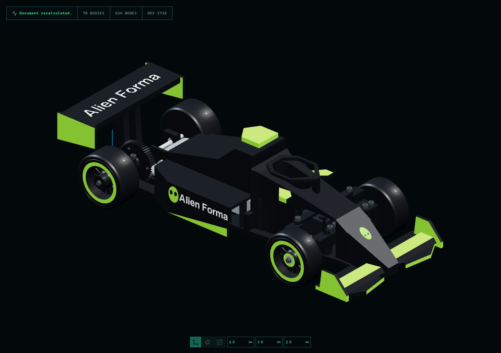
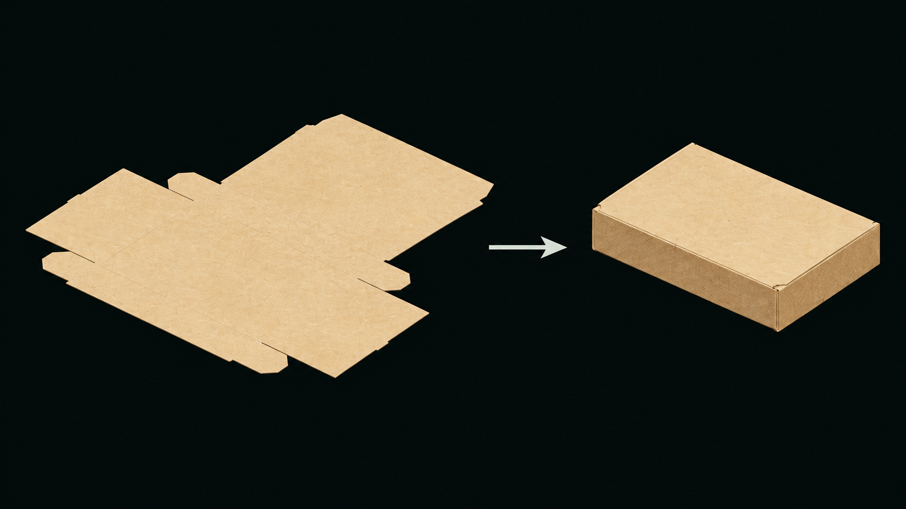

# Alien Forma

Parametric CAD by **CongestedAI**, with local modeling, painting and texturing tools, plus MCP integration for compatible AI assistants. “Forma” is the application's short name.

**[Microsoft Store](https://apps.microsoft.com/detail/9MW9G4MGBXZL) · [Official website](https://congestedai.github.io/Forma/) · [GitHub downloads](https://github.com/congestedai/Forma/releases) · [Install with a command](docs/INSTALACAO.md#macos-and-linux-command-line) · [Installation](docs/INSTALACAO.md) · [MCP](docs/MCP.md) · [Themes](docs/TEMAS.md)**

This repository contains official downloads, release notes, documentation, issue reports and distribution validation scripts. The original application source code is private. This repository does not grant an open-source license for the application.

## Downloads

| Distribution | Requirements |
| --- | --- |
| [Microsoft Store — 0.6.8.0](https://apps.microsoft.com/detail/9MW9G4MGBXZL) | Windows 10/11 x64. Install and manage updates through the Store. |
| Windows x64 portable | Run the executable; Node.js is not required. Preserve the adjacent `Forma-data` folder when updating. |
| Command-line package (.tgz) | Node.js 22.12 or newer; includes the compiled browser application and MCP bridge. |

Downloads and `SHA256SUMS.txt` are attached to each [release](https://github.com/congestedai/Forma/releases). [Alien Forma 0.6.9 Preview](https://github.com/congestedai/Forma/releases/tag/v0.6.9-preview.20261106) adds MCP raster tracing, world-space modeling receipts, Sketch image calibration, 3MF inspection and four-mode viewport captures. Windows x64 passed the portable and CLI smoke tests. [CLI and browser smoke tests for this exact download passed on Linux x64, Mac Intel and Apple Silicon](https://github.com/congestedai/Forma/actions/runs/42278917809).

**Release channels, updated 6 November 2026:** GitHub **0.6.9-preview.20261106**; Microsoft Store **0.6.8.0 published**. New previews arrive on **GitHub first**; Store updates follow Microsoft's review. Read the [channel guide](docs/VERSOES.md) before choosing a download.

## Made in the application

The F1 v20 study contains **70 bodies and 634 history nodes**, with image-derived markings, hardware details and technical views. Its A3 general arrangement uses third-angle projection, orthographic views at 1:2 and an isometric view at 1:5. [View the drawing PDF](docs/assets/f1-v20-general-arrangement.pdf) or [explore the screenshots](https://congestedai.github.io/Forma/#drawings). The native export retains some Portuguese labels. This is a CAD design example, not a physically validated RC-car kit or complete fabrication documentation.

Additional examples demonstrate foldable 3D boxes, rigid boxes with separate lids, foldable laser plans with distinct vector cut/score lines, and an image-derived three-color keychain. Assembled packaging poses are digital previews; material settings and hinge durability need physical testing.

Kraft packaging: AI-finished presentation based on a real native Alien Forma capture. The [original viewport image](docs/assets/packaging-kraft-viewport.png) is also available. This is a digital design example, not a physically validated carton.

The current releases are **previews**. No stable release has been published yet. Read the release notes for known limitations.

## Interface languages

Portuguese, English, Spanish, German, French, Japanese, Russian, and Simplified Chinese. Automatic detection follows browser/system preferences. Change the language in **File → Preferences**; the choice is saved locally. Language packs work offline and preserve project names, expressions, and model data. Translations are AI-assisted and feedback is welcome.

## Use and support

Free for personal, non-commercial use. **[Contribute US$1 to support Alien Forma](https://www.patreon.com/c/FormaCAD).**

Personal and commercial use conditions are described in the [license](LICENSE.txt), also supplied with the application. Contributions fund development. All users receive the same CAD tools.

## AI and MCP

Alien Forma is developed with the help of AI tools. MCP allows compatible clients to inspect and modify projects through the application's available tools. The integration is not exclusive to a particular provider or model. Results depend on the client's capabilities and configuration. See [MCP setup](docs/MCP.md).

## Credits and feedback

Alien Forma uses third-party libraries under their own licenses, including React, Three.js and Manifold. The [complete notices](THIRD_PARTY_NOTICES.txt) accompany every distribution. Alien Forma's license does not restrict rights granted by those libraries' authors.

[Report a problem](https://github.com/congestedai/Forma/issues/new/choose) with the exact version and a small reproduction. Community feedback is welcome through Issues. Pull requests are limited to invited collaborators. Never publish passwords, keys, personal documents or confidential projects.

Repository addresses, the `forma` command and `.forma.json` files retain their names for compatibility.
